# Taskbar Battery Widget

A Windows 11 taskbar widget that shows the battery level of your wireless devices, right next to the
notification area. Spec in `docs/spec.md`.

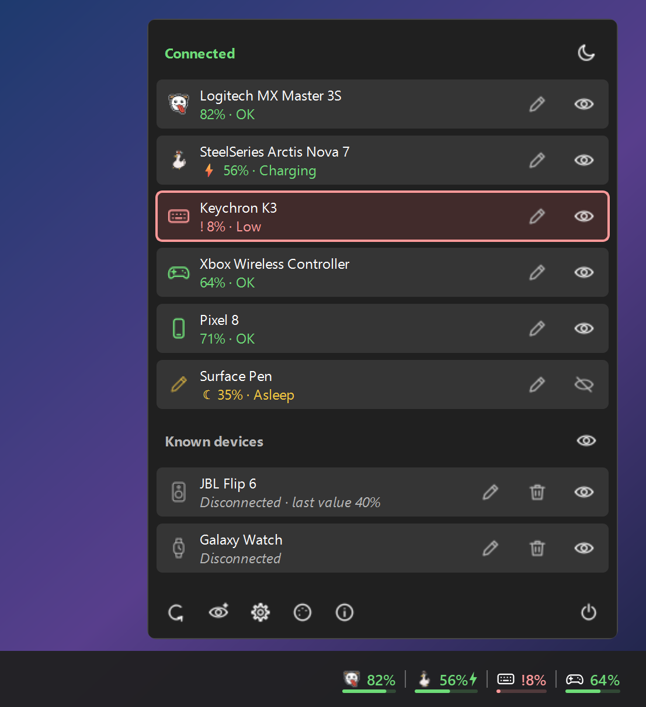

**[Download the latest release](https://github.com/Gabrielfch/taskbar-battery-widget/releases/latest)**

[](https://paypal.me/GabrielFChiarello)

## Download & install
Get one of these from the [Releases page](https://github.com/Gabrielfch/taskbar-battery-widget/releases/latest):
- `TaskbarBatteryWidget-Setup-x.y.z.exe`: per-user installer (no admin rights), optional start with Windows.
- `TaskbarBatteryWidget-portable-x.y.z.exe`: single file, no installation; just run it.

The builds are unsigned, so Windows SmartScreen may warn. Choose **More info -> Run anyway**.

Verify the download against `SHA256SUMS.txt` from the same release:
```powershell
Get-FileHash .\TaskbarBatteryWidget-Setup-x.y.z.exe -Algorithm SHA256
```
The hash printed must match the line for that file in `SHA256SUMS.txt`.

## Privacy
The app only connects to the internet when you look for updates: manually from *About* or through the
optional automatic check (off by default, at most once a day). The only hosts contacted are `api.github.com`
and `github.com` (the project's releases). What is sent is a plain HTTPS request with the User-Agent
`TaskbarBatteryWidget/<version>`; no device data, identifiers or personal data. Updates are downloaded only
after you confirm; `SHA256SUMS.txt` must carry a valid Ed25519 signature from the project's embedded key and the installer must match its hash before it runs (you confirm a second time before installing). Everything else runs
locally. It stores only:
- Settings: `%APPDATA%\TaskbarBatteryWidget\config.json`
- Logs: `%LOCALAPPDATA%\TaskbarBatteryWidget\logs` (`app.log`, `devices.log`), rotated at 1 MB x 3
- Optional detailed device logs: `%LOCALAPPDATA%\TaskbarBatteryWidget\logs\devices\`, one CSV file per device
  with one row per minute, capped at 4 MB per device (older rotated files are deleted after 90 days). Each
  file name is a sanitized device name followed by a salted hash of the device. The device name may be one
  you gave the device (for example its Bluetooth name), so check the file names before sharing them. The
  random per-install salt is stored outside the logs folder (`%LOCALAPPDATA%\TaskbarBatteryWidget\.detail_salt`),
  so the logs folder can be shared without it. This makes the hash hard to link back to a device, but
  it is not a guarantee that the hash cannot be guessed by someone who also has the salt and a candidate device id.
- Last known battery values: `%LOCALAPPDATA%\TaskbarBatteryWidget\last_known.json`

The contents of the logs, including the detailed device logs, never contain MAC addresses, serial numbers or
your user name.

Turning a source off in *Settings > Sources* (*2.4 GHz and USB* or *Bluetooth*) means the devices of that
source are not queried at all: they are not opened or read, not just hidden.

## Safety
Device readers send only read/query commands from a fixed whitelist; they never change device settings or
touch firmware. Most readers are on by default but are not yet confirmed on real hardware (🟢). Beta readers
(🧪) are **disabled by default** and only run when `beta_readers` is enabled (see [Configuration](#configuration)).

## Features
- One pill per device (kind icon + `NN%`), live updates, follows the light/dark taskbar theme.
- Turns red at or below a configurable low threshold; low-battery notifications with cooldown.
- Estimated "charging" state, hides over fullscreen apps, tray menu (refresh, show disconnected,
  notifications, low threshold, start with Windows, quit).
- UI in 7 languages (English, Spanish, Portuguese, French, Russian, Simplified Chinese, Japanese), following
  the Windows language by default; see [Languages](#languages).
- *About* window (tray menu): version, license, third-party notices, links, logs folder, copyable technical
  info, and *Check for updates* (manual, or optional once-a-day automatic check). Installed copies can
  download and install a new release after signature and SHA-256 verification; portable/source copies only open the release page.
- Logs in `%LOCALAPPDATA%\TaskbarBatteryWidget\logs` (`app.log` for the app, `TBW_DEBUG=1` for debug level;
  `devices.log` with connect/disconnect/battery/charging/low events per device; both rotate at 1 MB x 3 and
  never contain MAC addresses or serial numbers). Tray menu: *Open device log* / *Open logs folder*.
- Last known value: a disconnected device (or one that reports no level) keeps its last battery reading,
  dimmed, with "Disconnected · last value 56% 2 h ago" on the hover card; it never triggers low-battery alerts.
  Stored in `%LOCALAPPDATA%\TaskbarBatteryWidget\last_known.json` (max. 200 devices, purged after 90 days).
- Device panel: left or right click on the tray icon (or right click on the pills) opens a scrollable panel
  with *Connected* and *Known* devices. An eye icon per device shows or hides it on the taskbar; an icon
  toolbar at the bottom gives *Refresh*, *Show all*, *Settings*, *Personalization* (a palette button that opens
  that page directly; its back arrow returns to the device list), *About* and *Quit*. A sun / moon button at the
  top right of the panel switches between the light and the dark theme in one click. The panel stays open
  while the *Settings* menu, *About* or a statistics window is open, and closes when you click outside the app.
- Device order: drag a row in the panel to reorder it inside *Connected* or *Known*, or use Alt+Up / Alt+Down
  on the focused row, or the row's context menu (*Move up* / *Move down*). The pills and the panel follow the
  same order; showing / hiding or connecting / disconnecting a device never reorders. New devices go last.
- *Settings* (gear button) opens inside the panel and is navigated there: a back arrow returns to the previous
  page, pages open with a chevron, check boxes toggle in place and choice lists unfold below and stay open.
  Pages: *Sources* (*2.4 GHz and USB* — USB dongles and wired controllers — and *Bluetooth*, both on by
  default), *Alerts*, *Logs*, *Start with Windows*, *Personalization*, *Tutorial* and *What's new*.
- The panel has a fixed size, a fraction of the screen height (*Personalization ▸ Panel size*: compact, normal,
  large), and scrolls when the list or a page is longer.
- Theme (*Settings ▸ Personalization ▸ Theme*): **Automatic** (default, follows Windows), **Light** or **Dark**. It
  applies at once to the panel, its Settings pages and the app windows that use the system colours (About,
  statistics, tutorial, dialogs). The taskbar pills keep following the taskbar's own colours, except when the
  widget is floating, where they use the chosen theme. The sun / moon button of the panel sets it to light or dark.
- Personalization: colour palettes (classic, colour-blind friendly, pastel, high contrast, mono, or your own
  colours with automatic contrast correction), device icon styles (outline, filled, simple, retro pixel art,
  battery, none), pill style (**Classic**, **Soft**, **Transparent** — the default, no background, thin dividers
  between pills — or **Transparent compact**; low battery is then shown by the red value and a "!" and the critical
  pulse fades the text), interface scale (90–130 %, also for the taskbar pills) and language.
- Aliases: the pencil on a device row renames it (Enter saves, Esc cancels, empty restores the original name).
  Aliases are stored by device, so logs and statistics keep their history.
- First-run tutorial (six short illustrated steps; also in *Settings ▸ Tutorial*). Before installing an update,
  *About* shows the new version's notes; after updating, the app shows *What's new* once.
- Custom icons (*Settings ▸ Personalization ▸ Custom icons…*, or click the icon while editing an alias): PNG, JPG,
  BMP, ICO, GIF or SVG. An SVG (up to 512 KB; only basic shapes, paths, gradients and clip paths: no styles, text, filters, `<use>`, images or scripts, otherwise it is rejected) is converted to a 256×256 PNG on
  import. To create an icon with an AI chat, see the ready-made prompts in [docs/ICON_PROMPT.md](docs/ICON_PROMPT.md).
- Animated custom icons: a GIF or WebP with several frames works as an icon (up to 2 MB, 48 frames, 15 fps and 10 s; it is converted to a PNG strip on import, so the original file is not kept).
- Animations (*Settings ▸ Personalization ▸ Animations*): **Always**, **Follow Windows** (default; respects *Settings ▸ Accessibility ▸ Visual effects*) or **Never**. They drive animated icons, a soft pulse on the charging bolt and a slow pulse on the critical-battery pill. They pause in fullscreen apps and when nothing animated is visible.
- Forget device: in *Known devices* the trash button removes a device that is not connected, with its alias, custom icon and settings (after a confirmation; optionally also its detailed log). If it connects again it appears as new.
- Placement (*Settings ▸ Personalization ▸ Position*):
  - **Taskbar, right** (next to the tray, default) or **left** (needs centred Windows icons; otherwise the app
    warns and uses the right). Works with the taskbar on any edge; on vertical taskbars the pills go to the
    bottom end.
  - **Monitor**: primary or any other monitor, using that monitor's taskbar. A monitor without a taskbar shows
    the widget floating.
  - **Floating (draggable)**: drag it anywhere; it snaps to the nearest corner or edge and remembers its place
    per monitor. *Floating position* picks one of the 8 positions without dragging; *Reset position* brings it
    back to the bottom-right corner.
  - **Stack devices** (off by default): when floating (any position), shows one device per row in a column
    (every row as wide as the widest, growing away from its anchor; "+N" if it does not fit). On the taskbar
    the pills stay in a row.
  - **Visible in fullscreen** (off by default). Over a fullscreen app the widget lets clicks pass through and
    shows no hover card; hold **Shift** to use it.
  - **In fullscreen** (needs *Visible in fullscreen*): keep the usual position, or float on that monitor at a
    fixed corner/edge or at a draggable spot of its own (hold **Shift** and drag); it returns to the usual
    position when the fullscreen app closes. *Reset position* also forgets that spot.
- Optional detailed log per device: one CSV row per minute in `%LOCALAPPDATA%\TaskbarBatteryWidget\logs\devices\`
  (max. 4 MB per device, no MAC addresses or serial numbers).
  - **Statistics** (the *…* button of a recording device): number of charges, equivalent charge cycles,
    estimated runtime on a full charge, average time between charges, average drain (%/h), average charge time
    and gain, last charge, and charts of the battery level, daily drain and daily charges (24 h / 7 days /
    30 days / all). *Open log folder* is in the same window.
  - **Time left**: recording devices show "≈ 6 h left" (or "full in ≈ 40 min" while charging) in the panel
    and on the hover card, estimated from the last 7 days of their log (needs at least 6 h of discharge and a
    10 % drop).
- Full-charge notification (*Settings ▸ Alerts ▸ Notify when fully charged*, on by default): once per charge,
  when a device reaches 100 % (or stops charging at 99 % or more).

## Screenshots

All images use made-up devices and are generated by `tools/readme_screenshots.py`.

**Taskbar pills**, on a dark and on a light taskbar: a charging headset (bolt) and a low keyboard (red outline,
"!" before the level).

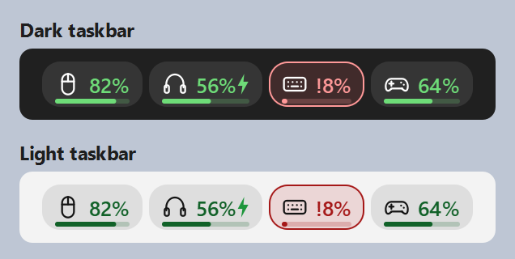

**Device panel**: connected and known devices, a hidden device (crossed eye), alias/forget buttons and the
bottom toolbar.

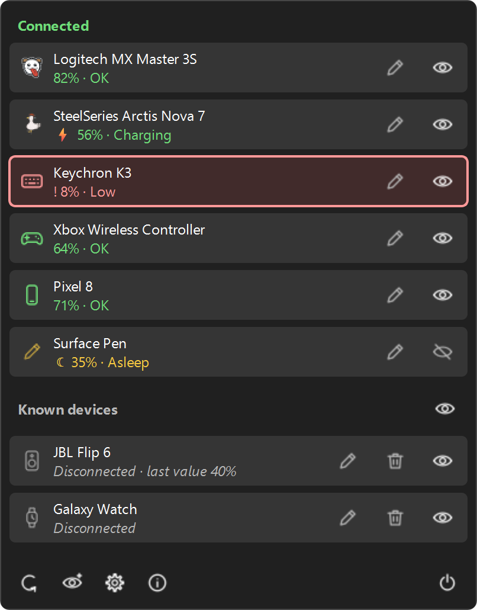

**Colors**: every palette on a dark and a light taskbar.

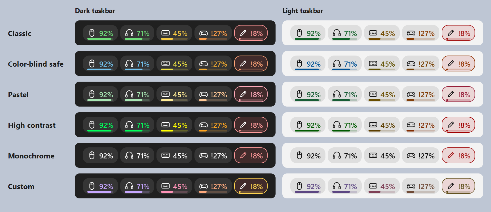

**Icon styles**: outline, filled, simple, retro pixel art, battery and text only.

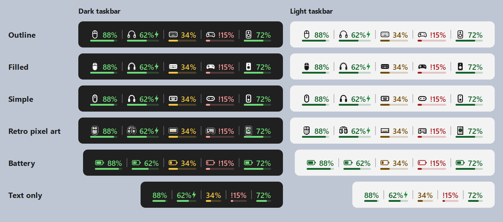

**Custom icons**: your own images (PNG, GIF, WebP, SVG...) per device or per device type, in the pills and in
the panel.

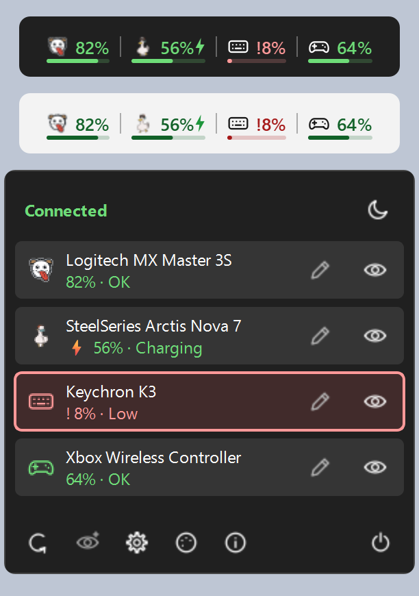

**Animations**: the charging bolt, the critical-level pulse and an animated custom icon. They follow the
Windows "Show animations" setting (or can be forced on/off).

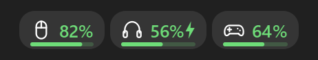
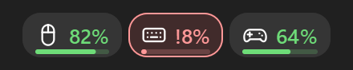
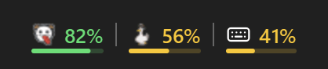

**Settings** live inside the panel: the *Personalization* page, and the colour choices.

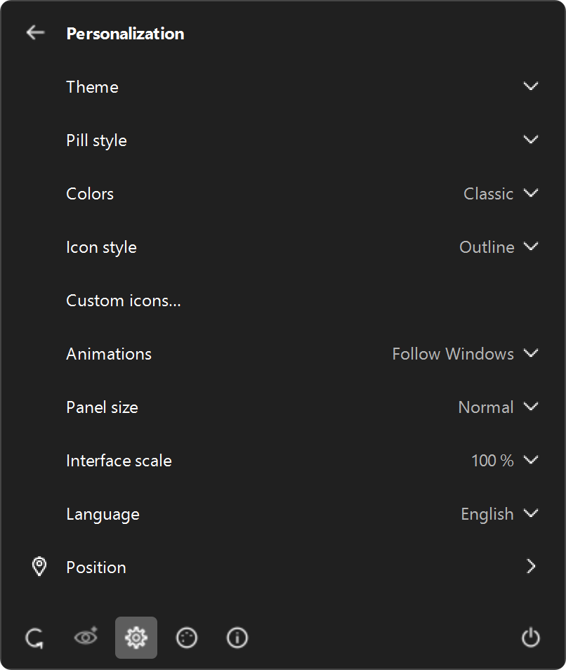
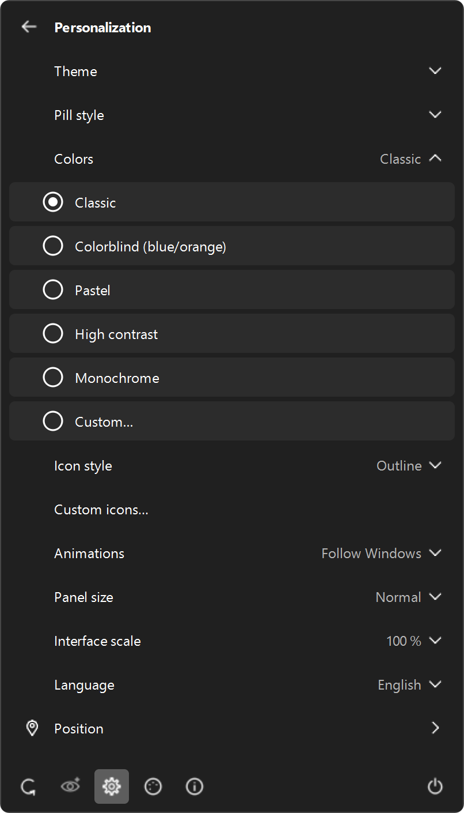

**Statistics** window of a recording device.

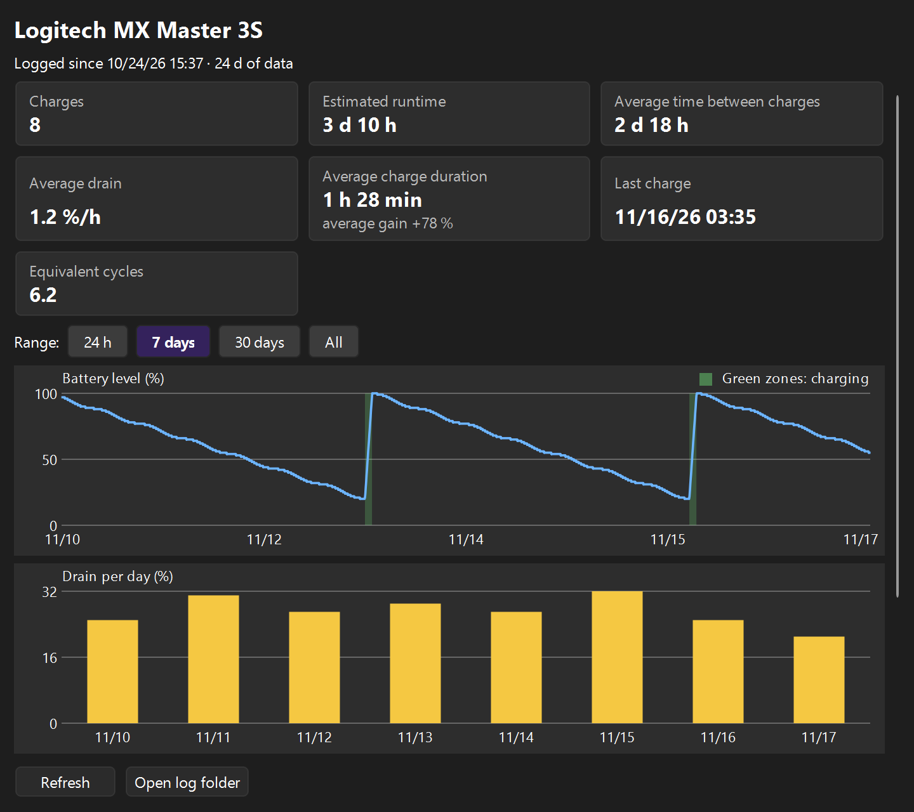

## Languages

Available languages: English, Español (Spanish), Português (Portuguese, Brazilian), Français (French),
Русский (Russian), 简体中文 (Simplified Chinese) and 日本語 (Japanese).

Choose one in *Settings ▸ Personalization ▸ Language*. *Automatic* follows the Windows language and falls
back to English when it is not one of the above. Dates, decimal separators and time units follow each language.

> Portuguese, French, Russian, Simplified Chinese and Japanese were machine-translated (AI) and may contain
> mistakes; corrections are welcome.

### Request a language

Open a [Translation / language request](https://github.com/Gabrielfch/taskbar-battery-widget/issues/new?template=translation.yml)
issue to ask for a new language or to correct a text.

### Contribute a translation

1. Copy the `EN = {...}` block of `taskbar_battery_widget/i18n.py` and translate every value, keeping the
   keys and the `{placeholders}` (such as `{name}` or `{n}`) unchanged.
2. Register it: add the language to `LANGUAGES`, assign your table to a name (for example `IT = {...}`) and add
   it to `_TABLES`. If its dates or decimals differ from English, add it to `DATE_STYLE` / `DECIMAL_COMMA`.
3. Run `.venv\Scripts\python.exe -m pytest tests\test_i18n_languages.py` (checks that all keys and placeholders match).
4. Open a pull request, or paste the translated block in an issue using the translation template.

### Translation credits

Your name here — help review a language!

## Compatibility

Legend: ✅ verified on real hardware · 🟢 implemented from public protocol notes, on by default, not yet tested
on real hardware · 🧪 beta reader, **off by default**: runs only when `"beta_readers": true` is set in the
advanced configuration (see [Configuration](#configuration)) · ❌ not supported.

> **Most readers have not been tested on real hardware.** Those marked 🟢 are implemented from public protocol
> documentation and are on by default. Only the ✅ rows have been verified on a real device.
>
> **Beta readers** (🧪) are off by default. They run only when `"beta_readers": true` is set in the advanced
> configuration. They are: Logitech PRO X 2 / PRO X 3 / G522 LIGHTSPEED headsets; Corsair Void Wireless V2,
> Virtuoso Max Wireless and HS80 Max Wireless; HyperX Cloud Alpha Wireless (03F0:098D) and Cloud II Wireless
> Kingston (0951:1718); SteelSeries Arctis 1, 7 and 9 families, Arctis Pro Wireless and Arctis Nova Pro Wireless;
> DualShock 4 over Bluetooth (USB stays on by default).
>
> **Tell us which devices work and which don't.** Open a
> [Device report](https://github.com/Gabrielfch/taskbar-battery-widget/issues/new?template=device_report.yml)
> and say whether the device **works**, shows a **wrong value**, or is **not shown** at all.

No vendor software (Synapse, G HUB, NGENUITY…) is needed; it may stay open at the same time. Every reader
only sends read/query commands from a fixed whitelist; a device that doesn't answer keeps its last value
until the idle grace period ends.

### Bluetooth (Classic and BLE)
Any paired device whose battery level Windows itself shows in *Settings → Bluetooth & devices*
(standard battery property).

| Device | Status |
| --- | --- |
| Xbox Wireless Controller (Bluetooth) | ✅ |
| Razer BlackShark V2 HyperSpeed (Bluetooth mode) | ✅ |
| Headphones, earbuds, mice, keyboards and pens that report battery to Windows | 🟢 |
| Devices that don't report battery to Windows (e.g. DualSense over BT → see Sony below) | ❌ via this path |

### Logitech (HID++ 2.0)
Devices behind a Logitech receiver or connected directly by USB, reporting battery through HID++ 2.0
features *Unified Battery* (0x1004), *Battery Status* (0x1000), *Battery Voltage* (0x1001) or
*ADC Measurement* (0x1F20).

| Device | Status |
| --- | --- |
| G903 LIGHTSPEED mouse (receiver C539) | ✅ |
| G915 WIRELESS keyboard (receiver C547) | ✅ |
| Other LIGHTSPEED, Unifying and Bolt receivers: PIDs C52B, C52F, C531, C532, C534, C539, C53A, C53D, C53F, C541, C545, C547, C548, C54D, C70E, C713 (or any HID++ device named "Receiver") | 🟢 |
| Recent Logitech mice, keyboards and LIGHTSPEED headsets (G/MX/ERGO/POP series) with HID++ 2.0 | 🟢 |
| Old HID++ 1.0-only devices (pre-2013 Unifying) — battery registers 0x07 / 0x0D (read only) | 🟢 |
| Headsets G533, G535, G633 / G635 / G733 / G933 / G935, G PRO / PRO X (older) | 🟢 |
| Headsets PRO X 2 LIGHTSPEED, PRO X 3 LIGHTSPEED, G522 LIGHTSPEED (Centurion protocol) | 🧪 |
| Astro A50 Gen 5 | 🟢 |
| G930, Astro A50 Gen 4 and older Astro | ❌ |

### Razer
| Device | Method | Status |
| --- | --- | --- |
| BlackShark V2 HyperSpeed — 2.4 GHz dongle 1532:0565 (battery + charging) | Direct dongle protocol | ✅ |
| Basilisk V3 Pro — 2.4 GHz dongle 1532:00AB (confirmed in [#1](https://github.com/Gabrielfch/taskbar-battery-widget/issues/1)) | Classic 90-byte protocol (mouse collection) | ✅ |
| Basilisk V3 Pro wired (1532:00AA), Basilisk V3 X HyperSpeed, Basilisk X HyperSpeed, Basilisk Ultimate (+ dongle) | Classic 90-byte protocol (vendor or mouse collection) | 🟢 |
| DeathAdder V2 Pro (wired/wireless), DeathAdder V2 X HyperSpeed, DeathAdder V3 Pro (wired/wireless) | Classic 90-byte protocol | 🟢 |
| Naga V2 Pro (wired/wireless), Viper V2 Pro (wired/wireless), Viper Ultimate (wired/wireless/dongle) | Classic 90-byte protocol | 🟢 |
| Cobra Pro (wired/wireless), Mouse Dock Pro, HyperPolling Wireless Dongle | Classic 90-byte protocol | 🟢 |
| BlackShark V2 Pro (RZ04-0322 and RZ04-0453) | Classic 90-byte protocol | 🟢 |
| Other Razer devices exposing the classic 90-byte feature report | Classic protocol (generic) | 🟢 |
| BlackShark V2 Pro PlayStation edition (needs a mode-changing command) | — | ❌ |
| Other Razer headsets with their own dongle protocol | — | ❌ |

### HyperX
| Device | Status |
| --- | --- |
| Cloud Flight Wireless (0951:16C4) — battery estimated from voltage, charging detected | ✅ |
| Cloud Flight Wireless, newer revision (0951:1723) | 🟢 |
| Cloud II Wireless (HP 03F0:0696, 03F0:018B) | 🟢 |
| Cloud II Wireless Kingston (0951:1718) | 🧪 |
| Cloud Alpha Wireless (03F0:098D) | 🧪 |
| Cloud Alpha 2 Wireless (03F0:08BE) | 🟢 |
| Cloud III Wireless, Cloud Alpha S, Stinger | ❌ |

### SteelSeries (1038)
| Device | Status |
| --- | --- |
| Arctis 1 / 1 Xbox / 7X / 7P, Arctis 7 / 7 (2019), Arctis 9 | 🧪 |
| Arctis 7+ (and PlayStation / Xbox / Destiny editions) | 🟢 |
| Arctis Nova 3P / 3X, Nova 5 / 5X, Nova 7 / 7X / 7P (and Diablo / WoW editions) | 🟢 |
| Arctis Nova Pro Wireless, Arctis Pro Wireless | 🧪 |
| Arctis GameBuds | 🟢 |

### Corsair (1B1C)
| Device | Status |
| --- | --- |
| Void / Void Pro / Void Elite / Void RGB wireless family (legacy protocol) | 🟢 |
| Virtuoso RGB Wireless XT / SE | 🟢 |
| Void Wireless V2, Virtuoso Max Wireless, HS80 Max Wireless | 🧪 |

### Audeze, Jabra, Lenovo, MCHOSE
| Device | Status |
| --- | --- |
| Audeze Maxwell, Maxwell 2 (PC and Xbox dongles) | 🟢 |
| Jabra Link 380, Jabra Link 390, Jabra Evolve2 65 Flex (USB) | 🟢 |
| Lenovo Wireless VoIP headset | 🟢 |
| MCHOSE X9, MCHOSE V9 Pro | 🟢 |
| Plantronics / Poly BT600 (needs session commands), Roccat Elo 7.1 Air (no battery query) | ❌ |

### Sony
| Device | Status |
| --- | --- |
| DualSense over USB (battery in 10 % steps + charging) | ✅ |
| DualSense over Bluetooth (switched to extended reports once per connection) | 🟢 |
| DualSense Edge (USB / Bluetooth) | 🟢 |
| DualShock 4 v1 / v2 and DS4 USB wireless adapter (USB) | 🟢 |
| DualShock 4 v1 / v2 over Bluetooth | 🧪 |
| PlayStation PULSE 3D headset (shown after the headset sends a status update) | 🟢 |
| INZONE H5, INZONE H9 II, INZONE Buds | 🟢 |

### Xbox
| Device | Status |
| --- | --- |
| Xbox controllers over Bluetooth | ✅ (see Bluetooth) |
| Xbox controllers through the Xbox Wireless Adapter or any XInput pad (battery in 4 steps: 5 / 30 / 65 / 100 %) | 🟢 |
| Xbox controller on a USB cable (Windows reports no battery level) | ❌ |

### 8BitDo (2DC8)
| Device | Status |
| --- | --- |
| Ultimate 2 Wireless — 2.4 GHz dongle (`2DC8:6013`) | 🟢 |
| Ultimate 2 Wireless (`2DC8:6012`), Ultimate 3 (`2DC8:202F`) — USB D-Input | 🟢 |
| Pro 2, Pro 3, SN30 Pro, SF30 Pro — USB D-Input (reads feature report `0x06`, which switches the controller to enhanced input reports for the session) | 🧪 |
| Ultimate 2C Wireless — 2.4 GHz dongle (`2DC8:310A`) or USB cable (firmware reports no battery %) | ❌ |

### Not supported yet
ASUS ROG, Turtle Beach, JBL and other vendor-specific dongles not listed above. Each needs its own protocol
reader.

## Run
```powershell
python -m venv .venv
.\.venv\Scripts\python -m pip install -r requirements.txt
.\.venv\Scripts\pythonw -m taskbar_battery_widget
```
Settings: `%APPDATA%\TaskbarBatteryWidget\config.json` (settings from the previous
`%APPDATA%\BtBatteryBar` folder are copied over on first run).

## Configuration
Settings are stored in `%APPDATA%\TaskbarBatteryWidget\config.json`. Advanced option: beta readers (🧪 in the
[compatibility tables](#compatibility)) are off by default. To enable them, add this key to `config.json`:
```json
{
  "beta_readers": true
}
```

## Tests
Dependencies are pinned; tests and the installer build need the dev set (`pytest`, `pyinstaller`):
```powershell
.\.venv\Scripts\python -m pip install -r requirements-dev.txt
.\.venv\Scripts\python -m pytest -q
```

## Build / Install
Users only need to run `TaskbarBatteryWidget-Setup-<version>.exe` (per-user install, no admin rights) or the
single-file `TaskbarBatteryWidget-portable-<version>.exe`. The builds are unsigned, so Windows SmartScreen
may warn ("More info" -> "Run anyway").

To build both (requires PyInstaller in the venv and Inno Setup 6):
```powershell
.\packaging\build.ps1
```
It runs the tests, generates the icon, builds the onedir and onefile apps and the installer, and writes
`dist\TaskbarBatteryWidget-Setup-<version>.exe` and `dist\TaskbarBatteryWidget-portable-<version>.exe`.

## Limitations
- While a Windows 11 shell flyout is open (Quick Settings, Start, notifications), the taskbar is drawn in a
  system layer above all normal windows, so the widget is hidden until the flyout closes. Avoiding this
  requires UIAccess (signed exe installed under Program Files).
- Windows 11 only. Bottom taskbars on two monitors verified on screen; other edges, vertical taskbars and
  mixed DPI are covered by unit tests only.
- *Visible in fullscreen* works over borderless/windowed fullscreen apps, not over exclusive DirectX fullscreen.
- The *left* position cannot know how many apps are on a centred taskbar; it keeps to the left quarter of the
  taskbar.
- Devices must expose their battery level through one of the supported methods above.

## Support the project
Taskbar Battery Widget is free and open source. If it is useful to you and you want to support its
development, you can make a donation via [PayPal](https://paypal.me/GabrielFChiarello). Reporting which
devices work (or don't) with the
[Device report](https://github.com/Gabrielfch/taskbar-battery-widget/issues/new?template=device_report.yml)
template helps just as much.

## Acknowledgements
Protocol facts come from public documentation; this is an independent implementation and no code was copied.
- [HeadsetControl](https://github.com/Sapd/HeadsetControl) (GPL-3.0): used only as a reference for protocol notes.
- [Solaar](https://github.com/pwr-Solaar/Solaar) and the Logitech HID++ documentation.
- Linux kernel drivers `hid-playstation`, `hid-sony` and `hid-logitech-hidpp`.
- [OpenRazer](https://github.com/openrazer/openrazer).
- [Tekk-Know/RazerBatteryTaskbar](https://github.com/Tekk-Know/RazerBatteryTaskbar).
- [SDL](https://github.com/libsdl-org/SDL) (`SDL_hidapi_8bitdo.c`) and [8bitdo-ultimate2-linux](https://github.com/MiguelSanzBr/8bitdo-ultimate2-linux).

## Disclaimer
Not affiliated with, endorsed or sponsored by Logitech, Razer, Sony, Microsoft, 8BitDo, HyperX/HP, SteelSeries,
Corsair, Audeze, Jabra, Lenovo or MCHOSE. Brand and product names are used only to indicate compatibility
and belong to their respective owners.

## License
[MIT](LICENSE). Bundled third-party components are listed in [THIRD_PARTY_NOTICES.md](THIRD_PARTY_NOTICES.md).
See also [CONTRIBUTING.md](CONTRIBUTING.md) and [SECURITY.md](SECURITY.md).
