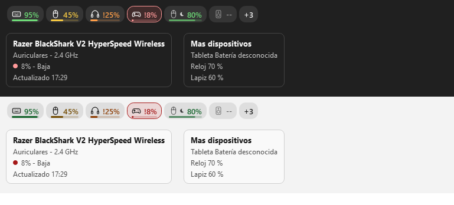

# Taskbar Battery Widget

A Windows 11 taskbar widget that shows the battery level of your wireless devices, right next to the
notification area. Spec in `docs/spec.md`.



**[Download the latest release](https://github.com/Gabrielfch/taskbar-battery-widget/releases/latest)**

## Download & install
Get one of these from the [Releases page](https://github.com/Gabrielfch/taskbar-battery-widget/releases/latest):
- `TaskbarBatteryWidget-Setup-x.y.z.exe`: per-user installer (no admin rights), optional start with Windows.
- `TaskbarBatteryWidget-portable-x.y.z.exe`: single file, no installation; just run it.

The builds are unsigned, so Windows SmartScreen may warn. Choose **More info -> Run anyway**.

Verify the download against `SHA256SUMS.txt` from the same release:
```powershell
Get-FileHash .\TaskbarBatteryWidget-Setup-x.y.z.exe -Algorithm SHA256
```
The hash printed must match the line for that file in `SHA256SUMS.txt`.

## Privacy
The app only connects to the internet when you look for updates: manually from *About* or through the
optional automatic check (off by default, at most once a day). The only hosts contacted are `api.github.com`
and `github.com` (the project's releases). What is sent is a plain HTTPS request with the User-Agent
`TaskbarBatteryWidget/<version>`; no device data, identifiers or personal data. Updates are downloaded only
after you confirm; `SHA256SUMS.txt` must carry a valid Ed25519 signature from the project's embedded key and the installer must match its hash before it runs (you confirm a second time before installing). Everything else runs
locally. It stores only:
- Settings: `%APPDATA%\TaskbarBatteryWidget\config.json`
- Logs: `%LOCALAPPDATA%\TaskbarBatteryWidget\logs` (`app.log`, `devices.log`), rotated at 1 MB x 3
- Optional detailed device logs: `%LOCALAPPDATA%\TaskbarBatteryWidget\logs\devices\`, one CSV file per device
  with one row per minute, capped at 4 MB per device (older rotated files are deleted after 90 days). Each
  file name is a sanitized device name followed by a salted hash of the device. The device name may be one
  you gave the device (for example its Bluetooth name), so check the file names before sharing them. The
  random per-install salt is stored outside the logs folder (`%LOCALAPPDATA%\TaskbarBatteryWidget\.detail_salt`),
  so the logs folder can be shared without it. This makes the hash hard to link back to a device, but
  it is not a guarantee that the hash cannot be guessed by someone who also has the salt and a candidate device id.
- Last known battery values: `%LOCALAPPDATA%\TaskbarBatteryWidget\last_known.json`

The contents of the logs, including the detailed device logs, never contain MAC addresses, serial numbers or
your user name.

Turning a source off in *Settings > Sources* (*2.4 GHz and USB* or *Bluetooth*) means the devices of that
source are not queried at all: they are not opened or read, not just hidden.

## Safety
Device readers send only read/query commands from a fixed whitelist; they never change device settings or
touch firmware. Most readers are on by default but are not yet confirmed on real hardware (🟢). Beta readers
(🧪) are **disabled by default** and only run when `beta_readers` is enabled (see [Configuration](#configuration)).

## Features
- One pill per device (kind icon + `NN%`), live updates, follows the light/dark taskbar theme.
- Turns red at or below a configurable low threshold; low-battery notifications with cooldown.
- Estimated "charging" state, hides over fullscreen apps, tray menu (refresh, show disconnected,
  notifications, low threshold, start with Windows, quit).
- Spanish / English UI depending on the system locale.
- *About* window (tray menu): version, license, third-party notices, links, logs folder, copyable technical
  info, and *Check for updates* (manual, or optional once-a-day automatic check). Installed copies can
  download and install a new release after signature and SHA-256 verification; portable/source copies only open the release page.
- Logs in `%LOCALAPPDATA%\TaskbarBatteryWidget\logs` (`app.log` for the app, `TBW_DEBUG=1` for debug level;
  `devices.log` with connect/disconnect/battery/charging/low events per device; both rotate at 1 MB x 3 and
  never contain MAC addresses or serial numbers). Tray menu: *Open device log* / *Open logs folder*.
- Last known value: a disconnected device (or one that reports no level) keeps its last battery reading,
  dimmed, with "Disconnected · last value 56% 2 h ago" on the hover card; it never triggers low-battery alerts.
  Stored in `%LOCALAPPDATA%\TaskbarBatteryWidget\last_known.json` (max. 200 devices, purged after 90 days).
- Device panel: left-click the tray icon to open a scrollable panel with *Connected* and *Known* devices. An
  eye icon per device shows or hides it on the taskbar.
- *Settings* submenu in the tray menu, with *Sources*: *2.4 GHz and USB* (USB dongles and wired controllers)
  and *Bluetooth*. Both are on by default.
- Optional detailed log per device: one CSV row per minute in `%LOCALAPPDATA%\TaskbarBatteryWidget\logs\devices\`
  (max. 4 MB per device, no MAC addresses or serial numbers).

## Compatibility

Legend: ✅ verified on real hardware · 🟢 implemented from public protocol notes, on by default, not yet tested
on real hardware · 🧪 beta reader, **off by default**: runs only when `"beta_readers": true` is set in the
advanced configuration (see [Configuration](#configuration)) · ❌ not supported.

> **Most readers have not been tested on real hardware.** Those marked 🟢 are implemented from public protocol
> documentation and are on by default. Only the ✅ rows have been verified on a real device.
>
> **Beta readers** (🧪) are off by default. They run only when `"beta_readers": true` is set in the advanced
> configuration. They are: Logitech PRO X 2 / PRO X 3 / G522 LIGHTSPEED headsets; Corsair Void Wireless V2,
> Virtuoso Max Wireless and HS80 Max Wireless; HyperX Cloud Alpha Wireless (03F0:098D) and Cloud II Wireless
> Kingston (0951:1718); SteelSeries Arctis 1, 7 and 9 families, Arctis Pro Wireless and Arctis Nova Pro Wireless;
> DualShock 4 over Bluetooth (USB stays on by default).
>
> **Tell us which devices work and which don't.** Open a
> [Device report](https://github.com/Gabrielfch/taskbar-battery-widget/issues/new?template=device_report.yml)
> and say whether the device **works**, shows a **wrong value**, or is **not shown** at all.

No vendor software (Synapse, G HUB, NGENUITY…) is needed; it may stay open at the same time. Every reader
only sends read/query commands from a fixed whitelist; a device that doesn't answer keeps its last value
until the idle grace period ends.

### Bluetooth (Classic and BLE)
Any paired device whose battery level Windows itself shows in *Settings → Bluetooth & devices*
(standard battery property).

| Device | Status |
| --- | --- |
| Xbox Wireless Controller (Bluetooth) | ✅ |
| Razer BlackShark V2 HyperSpeed (Bluetooth mode) | ✅ |
| Headphones, earbuds, mice, keyboards and pens that report battery to Windows | 🟢 |
| Devices that don't report battery to Windows (e.g. DualSense over BT → see Sony below) | ❌ via this path |

### Logitech (HID++ 2.0)
Devices behind a Logitech receiver or connected directly by USB, reporting battery through HID++ 2.0
features *Unified Battery* (0x1004), *Battery Status* (0x1000), *Battery Voltage* (0x1001) or
*ADC Measurement* (0x1F20).

| Device | Status |
| --- | --- |
| G903 LIGHTSPEED mouse (receiver C539) | ✅ |
| G915 WIRELESS keyboard (receiver C547) | ✅ |
| Other LIGHTSPEED, Unifying and Bolt receivers: PIDs C52B, C52F, C531, C532, C534, C539, C53A, C53D, C53F, C541, C545, C547, C548, C54D, C70E, C713 (or any HID++ device named "Receiver") | 🟢 |
| Recent Logitech mice, keyboards and LIGHTSPEED headsets (G/MX/ERGO/POP series) with HID++ 2.0 | 🟢 |
| Old HID++ 1.0-only devices (pre-2013 Unifying) — battery registers 0x07 / 0x0D (read only) | 🟢 |
| Headsets G533, G535, G633 / G635 / G733 / G933 / G935, G PRO / PRO X (older) | 🟢 |
| Headsets PRO X 2 LIGHTSPEED, PRO X 3 LIGHTSPEED, G522 LIGHTSPEED (Centurion protocol) | 🧪 |
| Astro A50 Gen 5 | 🟢 |
| G930, Astro A50 Gen 4 and older Astro | ❌ |

### Razer
| Device | Method | Status |
| --- | --- | --- |
| BlackShark V2 HyperSpeed — 2.4 GHz dongle 1532:0565 (battery + charging) | Direct dongle protocol | ✅ |
| Basilisk V3 Pro (wired/wireless), Basilisk V3 X HyperSpeed, Basilisk X HyperSpeed, Basilisk Ultimate (+ dongle) | Classic 90-byte protocol | 🟢 |
| DeathAdder V2 Pro (wired/wireless), DeathAdder V2 X HyperSpeed, DeathAdder V3 Pro (wired/wireless) | Classic 90-byte protocol | 🟢 |
| Naga V2 Pro (wired/wireless), Viper V2 Pro (wired/wireless), Viper Ultimate (wired/wireless/dongle) | Classic 90-byte protocol | 🟢 |
| Cobra Pro (wired/wireless), Mouse Dock Pro, HyperPolling Wireless Dongle | Classic 90-byte protocol | 🟢 |
| BlackShark V2 Pro (RZ04-0322 and RZ04-0453) | Classic 90-byte protocol | 🟢 |
| Other Razer devices exposing the classic 90-byte feature report | Classic protocol (generic) | 🟢 |
| BlackShark V2 Pro PlayStation edition (needs a mode-changing command) | — | ❌ |
| Other Razer headsets with their own dongle protocol | — | ❌ |

### HyperX
| Device | Status |
| --- | --- |
| Cloud Flight Wireless (0951:16C4) — battery estimated from voltage, charging detected | ✅ |
| Cloud Flight Wireless, newer revision (0951:1723) | 🟢 |
| Cloud II Wireless (HP 03F0:0696, 03F0:018B) | 🟢 |
| Cloud II Wireless Kingston (0951:1718) | 🧪 |
| Cloud Alpha Wireless (03F0:098D) | 🧪 |
| Cloud Alpha 2 Wireless (03F0:08BE) | 🟢 |
| Cloud III Wireless, Cloud Alpha S, Stinger | ❌ |

### SteelSeries (1038)
| Device | Status |
| --- | --- |
| Arctis 1 / 1 Xbox / 7X / 7P, Arctis 7 / 7 (2019), Arctis 9 | 🧪 |
| Arctis 7+ (and PlayStation / Xbox / Destiny editions) | 🟢 |
| Arctis Nova 3P / 3X, Nova 5 / 5X, Nova 7 / 7X / 7P (and Diablo / WoW editions) | 🟢 |
| Arctis Nova Pro Wireless, Arctis Pro Wireless | 🧪 |
| Arctis GameBuds | 🟢 |

### Corsair (1B1C)
| Device | Status |
| --- | --- |
| Void / Void Pro / Void Elite / Void RGB wireless family (legacy protocol) | 🟢 |
| Virtuoso RGB Wireless XT / SE | 🟢 |
| Void Wireless V2, Virtuoso Max Wireless, HS80 Max Wireless | 🧪 |

### Audeze, Jabra, Lenovo, MCHOSE
| Device | Status |
| --- | --- |
| Audeze Maxwell, Maxwell 2 (PC and Xbox dongles) | 🟢 |
| Jabra Link 380, Jabra Link 390, Jabra Evolve2 65 Flex (USB) | 🟢 |
| Lenovo Wireless VoIP headset | 🟢 |
| MCHOSE X9, MCHOSE V9 Pro | 🟢 |
| Plantronics / Poly BT600 (needs session commands), Roccat Elo 7.1 Air (no battery query) | ❌ |

### Sony
| Device | Status |
| --- | --- |
| DualSense over USB (battery in 10 % steps + charging) | ✅ |
| DualSense over Bluetooth (switched to extended reports once per connection) | 🟢 |
| DualSense Edge (USB / Bluetooth) | 🟢 |
| DualShock 4 v1 / v2 and DS4 USB wireless adapter (USB) | 🟢 |
| DualShock 4 v1 / v2 over Bluetooth | 🧪 |
| PlayStation PULSE 3D headset (shown after the headset sends a status update) | 🟢 |
| INZONE H5, INZONE H9 II, INZONE Buds | 🟢 |

### Xbox
| Device | Status |
| --- | --- |
| Xbox controllers over Bluetooth | ✅ (see Bluetooth) |
| Xbox controllers through the Xbox Wireless Adapter or any XInput pad (battery in 4 steps: 5 / 30 / 65 / 100 %) | 🟢 |
| Xbox controller on a USB cable (Windows reports no battery level) | ❌ |

### Not supported yet
ASUS ROG, Turtle Beach, JBL and other vendor-specific dongles not listed above. Each needs its own protocol
reader.

## Run
```powershell
python -m venv .venv
.\.venv\Scripts\python -m pip install -r requirements.txt
.\.venv\Scripts\pythonw -m taskbar_battery_widget
```
Settings: `%APPDATA%\TaskbarBatteryWidget\config.json` (settings from the previous
`%APPDATA%\BtBatteryBar` folder are copied over on first run).

## Configuration
Settings are stored in `%APPDATA%\TaskbarBatteryWidget\config.json`. Advanced option: beta readers (🧪 in the
[compatibility tables](#compatibility)) are off by default. To enable them, add this key to `config.json`:
```json
{
  "beta_readers": true
}
```

## Tests
Dependencies are pinned; tests and the installer build need the dev set (`pytest`, `pyinstaller`):
```powershell
.\.venv\Scripts\python -m pip install -r requirements-dev.txt
.\.venv\Scripts\python -m pytest -q
```

## Build / Install
Users only need to run `TaskbarBatteryWidget-Setup-<version>.exe` (per-user install, no admin rights) or the
single-file `TaskbarBatteryWidget-portable-<version>.exe`. The builds are unsigned, so Windows SmartScreen
may warn ("More info" -> "Run anyway").

To build both (requires PyInstaller in the venv and Inno Setup 6):
```powershell
.\packaging\build.ps1
```
It runs the tests, generates the icon, builds the onedir and onefile apps and the installer, and writes
`dist\TaskbarBatteryWidget-Setup-<version>.exe` and `dist\TaskbarBatteryWidget-portable-<version>.exe`.

## Limitations
- While a Windows 11 shell flyout is open (Quick Settings, Start, notifications), the taskbar is drawn in a
  system layer above all normal windows, so the widget is hidden until the flyout closes. Avoiding this
  requires UIAccess (signed exe installed under Program Files).
- Windows 11 only; primary taskbar only (bottom edge verified on screen, others by unit tests).
- Devices must expose their battery level through one of the supported methods above.

## Acknowledgements
Protocol facts come from public documentation; this is an independent implementation and no code was copied.
- [HeadsetControl](https://github.com/Sapd/HeadsetControl) (GPL-3.0): used only as a reference for protocol notes.
- [Solaar](https://github.com/pwr-Solaar/Solaar) and the Logitech HID++ documentation.
- Linux kernel drivers `hid-playstation`, `hid-sony` and `hid-logitech-hidpp`.
- [OpenRazer](https://github.com/openrazer/openrazer).
- [Tekk-Know/RazerBatteryTaskbar](https://github.com/Tekk-Know/RazerBatteryTaskbar).

## Disclaimer
Not affiliated with, endorsed or sponsored by Logitech, Razer, Sony, Microsoft, HyperX/HP, SteelSeries,
Corsair, Audeze, Jabra, Lenovo or MCHOSE. Brand and product names are used only to indicate compatibility
and belong to their respective owners.

## License
[MIT](LICENSE). Bundled third-party components are listed in [THIRD_PARTY_NOTICES.md](THIRD_PARTY_NOTICES.md).
See also [CONTRIBUTING.md](CONTRIBUTING.md) and [SECURITY.md](SECURITY.md).
